<p align="center">
  <a href="https://abdulbasitbehlim.github.io/">
    
  </a>
</p>

<p align="center">
  <a href="https://abdulbasitbehlim.github.io/"><b>Visit the live site →</b></a>
  &nbsp;·&nbsp;
  <a href="https://scholar.google.com/citations?hl=en&user=sKZ_zJoAAAAJ">Google Scholar</a>
  &nbsp;·&nbsp;
  <a href="https://orcid.org/0009-0003-5240-5413">ORCID</a>
  &nbsp;·&nbsp;
  <a href="https://www.linkedin.com/in/abdulbasitbehlim">LinkedIn</a>
</p>

# Abdul Basit Behlim — Research Portfolio

The personal research portfolio of **Abdul Basit Behlim**, Computational Biologist & Bioinformatician, hosted with GitHub Pages.

I work where biotechnology meets code: CRISPR guide design, bioprocess machine learning, and the discovery of endolysins against drug-resistant bacteria.

## What's on the site

| Page | What it covers |
| --- | --- |
| [Home](https://abdulbasitbehlim.github.io/) | Introduction, current work and selected projects |
| [About](https://abdulbasitbehlim.github.io/about.html) | Background and toolkit |
| [Journey](https://abdulbasitbehlim.github.io/journey.html) | Education, research experience, examinations and awards |
| [Work](https://abdulbasitbehlim.github.io/work.html) | Six projects, from CRISPR design tools to endolysin discovery |
| [Publications](https://abdulbasitbehlim.github.io/publications.html) | Preprint, citation and academic profiles |
| [Contact](https://abdulbasitbehlim.github.io/contact.html) | Email and a message form |

## Design and features

- **Glass interface** — frosted panels over a slowly moving colour background, in light and dark mode.
- **A name made of sand** — the first screen draws the name from thousands of particles that scatter under the cursor and flow back.
- **Live science** — rotating DNA helices, a miniature CRISPR guide finder that scans a demo sequence for NGG sites, and animated project figures.
- **Accessible by default** — keyboard navigation, visible focus, readable contrast, and animations that step back when a device asks for reduced motion.
- **No build step** — plain HTML, CSS and JavaScript with no frameworks.

## Project structure

```
.
├── index.html            Home
├── about.html            About
├── journey.html          Journey
├── work.html             Work
├── publications.html     Publications
├── contact.html          Contact and message form
├── styles.css            All styling
├── script.js             All behaviour and animations
├── assets/               Images and the README banner
├── server/               Optional message inbox (Cloudflare Worker)
├── sitemap.xml
└── robots.txt
```

## Run it locally

No installation is needed. Open `index.html` in a browser, or serve the folder:

```bash
python3 -m http.server 8080
```

Then visit `http://localhost:8080`.

## Message inbox

The contact form can save visitors' messages as files in a private GitHub repository through a small Cloudflare Worker. Until that is set up, the form opens the visitor's email app instead. Set-up steps are in [server/README.md](server/README.md).

## Licensing

All source code and portfolio material in this repository were created and authored by **Abdul Basit Behlim**.

- Original HTML, CSS and JavaScript written for this website are available under the **MIT License**. See [LICENSE-CODE.md](LICENSE-CODE.md).
- Portfolio text, research and project descriptions, biography, branding, original visual assets and other non-code content are **Copyright © 2026 Abdul Basit Behlim — All rights reserved**. See [CONTENT-LICENSE.md](CONTENT-LICENSE.md).

See [LICENSE](LICENSE) for the repository-wide licensing notice.
